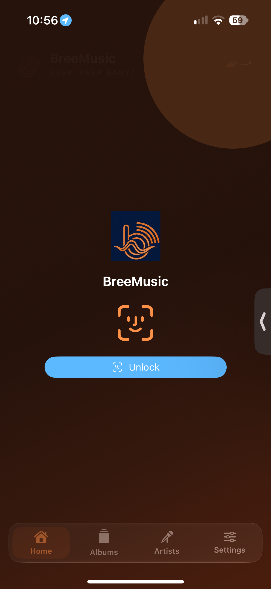
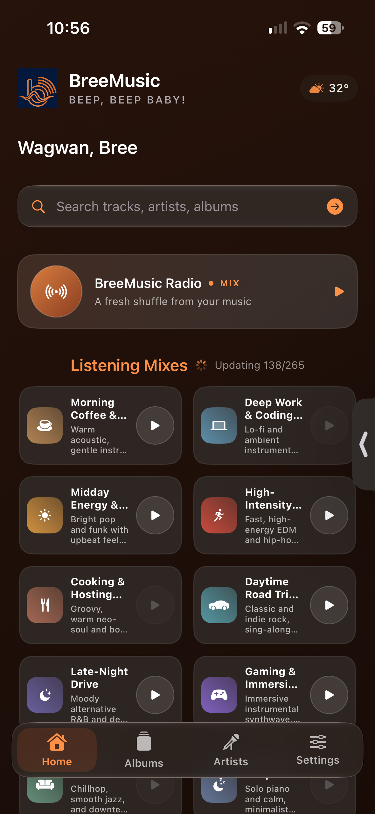
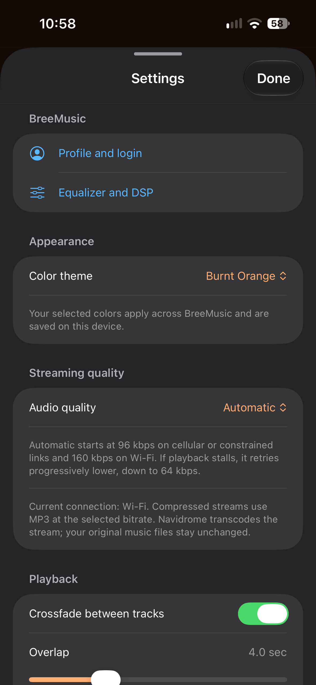
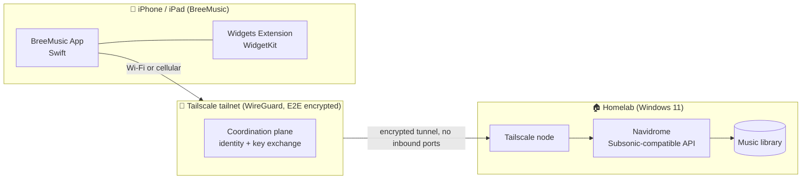
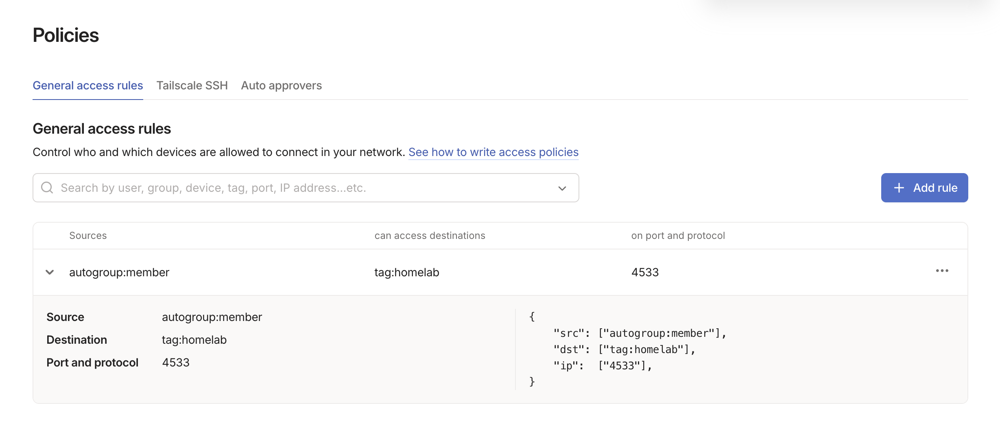
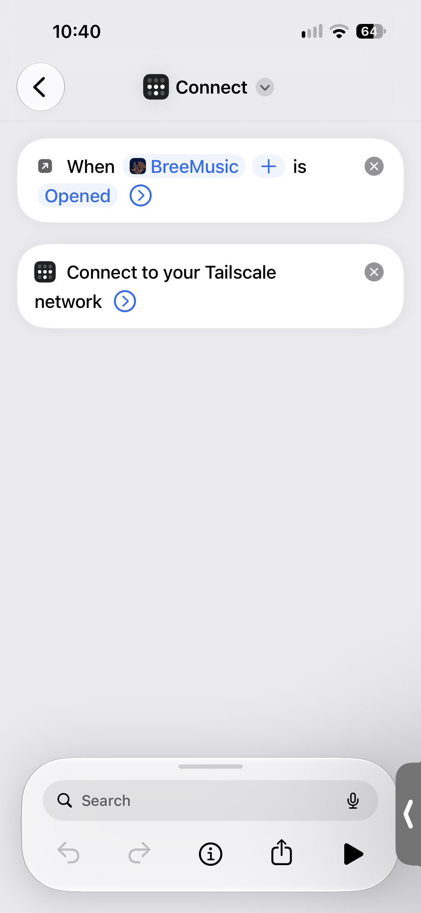
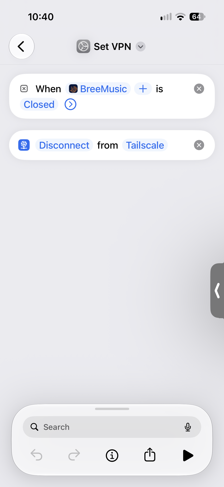

<div align="center">

# 🎵 BreeMusic

**A self-hosted, zero-subscription music streaming platform — native iOS client, Navidrome backend, Tailscale zero-trust network.**


-green)


[Architecture](#-architecture) · [Security Design](#-security-design) · [Threat Model](#-threat-model) · [Setup](#-setup) · [Skills Demonstrated](#-skills-demonstrated) · [Roadmap](#-roadmap)

<p align="center">
  
  
  
</p>

</div>

---

## Overview

BreeMusic is a personal streaming system I designed, built, and operate end to end. It replaces paid music subscriptions with infrastructure I own: a **Navidrome** server hosting my library on my homelab, a **native Swift/SwiftUI client** (with a Home Screen widget extension), and **Tailscale** providing encrypted, authenticated access from anywhere — including over cellular — **without opening a single inbound port** on my home network.

It started as a cost-saving project. It became a hands-on exercise in the same things a security team cares about: minimizing attack surface, authenticating every device, encrypting traffic in transit, and treating the home network as untrusted.

| | |
|---|---|
| **Problem** | Recurring streaming subscription costs; no ownership of the library or the data |
| **Solution** | Self-hosted Navidrome + custom native client + private mesh VPN |
| **Result** | Full library access on mobile data from anywhere, no subscription, no public exposure |
| **Role** | Solo — architecture, networking, security, client development, operations |

---

## ✨ Features

- **Biometric lock:** the app opens behind a Face ID prompt, adding a second factor on top of the device passcode
- **Adaptive streaming:** Automatic quality starts at 96 kbps on cellular or constrained links and 160 kbps on Wi-Fi, then retries progressively lower (down to 64 kbps) if playback stalls. Navidrome transcodes to MP3 on the fly; original files are never modified
- **Library browsing:** Home, Albums, and Artists tabs, genre filters, and search across tracks, artists, and albums
- **Listening Mixes and Radio:** mood/activity mixes and a one-tap shuffle of the whole library
- **Playback:** Now Playing screen, mini player, crossfade (adjustable overlap), repeat/shuffle, equalizer and DSP
- **Customization:** selectable color themes, saved on-device
- **Home Screen widget** via a WidgetKit extension
- **Network automation:** VPN connects on app open and disconnects on close (see Security Design)

---

## 🏗 Architecture



### Components

| Layer | Technology | Responsibility |
|---|---|---|
| Client | Swift, Xcode, WidgetKit | Browse, search, and stream the library; Home Screen widget |
| Automation | iOS Shortcuts | Turns the VPN on when the app opens and off when it closes |
| Transport | Tailscale (WireGuard) | Device-authenticated, encrypted private network; works over Wi-Fi and cellular |
| Server | Navidrome | Library indexing, transcoding, streaming API |
| Host | Windows 11 homelab | Runs Navidrome and the Tailscale node; stores the library |

### Project structure

```
BreeMusic/
├── BreeMusic/                  # Main app target
├── BreeMusicWidgets/           # WidgetKit extension target
├── BreeMusic.xcodeproj/
└── docs/                       # Diagrams, screenshots, writeups
```

### Build configuration (from the Xcode project)

- **Targets:** `BreeMusic` (application) and `BreeMusicWidgetsExtension` (app extension, embedded in the app)
- **Platforms:** iOS, iPadOS, macOS, and visionOS (`SUPPORTED_PLATFORMS = iphoneos iphonesimulator macosx xros xrsimulator`)
- **Language:** Swift 5 mode with approachable concurrency and `MainActor` default isolation
- **Frameworks:** SwiftUI and WidgetKit (widget target)
- **Signing:** Automatic code signing, Release builds with dSYM generation and whole-module optimization
- **Sandboxing:** App Sandbox enabled; script sandboxing enabled for the build
- **Privacy strings:** `NSLocalNetworkUsageDescription` set so the local-network permission prompt is explained to the user

---

## 🔒 Security Design

Security was a design input from day one, not an afterthought.

### 1. No inbound exposure
No port forwarding, no dynamic DNS, no public reverse proxy. The home network's attack surface from the internet is unchanged by this project. Tailscale nodes make outbound connections only and are reached through authenticated WireGuard tunnels.

### 2. Zero-trust access and least-privilege ACL
Only devices enrolled in my tailnet and authorized by my identity can reach the server. Possession of the URL is not enough — an unenrolled device cannot even route to the host.

<p align="center">
  
</p>

The tailnet policy is default-deny. The only rule allows my own devices (`autogroup:member`) to reach the homelab host (`tag:homelab`) on **port 4533 only**. Every other port on that machine is unreachable over the tailnet, so a compromised or misused device can't pivot to RDP, SMB, or other services.

### 3. Encryption in transit
All client-to-server traffic rides inside WireGuard (Curve25519 key exchange, ChaCha20-Poly1305), end to end between my phone and my server — including on untrusted Wi-Fi and cellular networks.

### 4. Least privilege and separation
- Navidrome runs as its own service with access to the music library only
- The library is exposed to the app through the API, not as a file share
- The client holds credentials for one service, not for the host

### 5. Automated VPN lifecycle (time-boxed exposure)
An **iOS Shortcuts personal automation** ties the tunnel to the app: opening BreeMusic turns the VPN on, and closing it turns the VPN off. The phone is therefore only a live tailnet member while it is actually in use, which:
- shrinks the window in which the device is reachable on the tailnet
- removes the "forgot to connect / forgot to disconnect" failure mode
- keeps normal traffic and battery behavior outside of listening sessions

<p align="center">
  
  
</p>

Trade-off: automation depends on iOS Shortcuts triggers firing reliably, so the tunnel can occasionally lag app launch. Tailscale ACLs (section 2) remain the primary access control; this is defense in depth and usability, not a replacement.

### 6. Secrets hygiene
- No server addresses, tokens, or credentials are committed to this repository
- Configuration is supplied at runtime; credential storage is intended for the Keychain
- Automated secret scanning (gitleaks) runs on every push and pull request, with custom rules that catch Tailscale auth keys, tailnet hostnames, and tailnet IPs
- `.gitignore` excludes Xcode per-user state (`xcuserdata`, `*.xcuserstate`), which can leak machine paths and window state

> 🔧 **Verify before publishing:** confirm the app stores the Navidrome credential in the Keychain (not `UserDefaults`) and that it connects over the Tailscale hostname/IP rather than a hardcoded public address. Update this section to match the code.

---

## 🛡 Threat Model

A lightweight STRIDE-style review of the system.

| # | Threat | Category | Mitigation | Residual risk |
|---|---|---|---|---|
| 1 | Internet scanner finds and attacks the Navidrome service | Info disclosure / EoP | Service not exposed publicly; reachable only on the tailnet | Low |
| 2 | Eavesdropping on public Wi-Fi or cellular | Info disclosure | WireGuard tunnel end to end | Low |
| 3 | Lost or stolen phone gains access to the library | Spoofing | Device passcode, in-app Face ID lock, + ability to remove the device from the tailnet; key expiry | Medium — depends on device lock and fast revocation |
| 4 | Credential theft from the client | Info disclosure | Keychain storage, per-service credentials, no secrets in repo | Low–Medium |
| 5 | Compromise of the Navidrome host | EoP | Least-privilege service account, OS patching, tailnet ACLs restricting who can reach what | Medium — single-host homelab |
| 6 | Vulnerable Navidrome version | Tampering | Track upstream releases and update promptly | Medium — requires ongoing patching |
| 7 | Accidental secret or hostname leak in Git | Info disclosure | `.gitignore`, pre-commit review, no config in repo | Low |

### Hardening roadmap
- [x] Tailscale ACLs scoped so my devices can reach only the Navidrome port (4533) on the tagged homelab host
- [ ] Device approval and key-expiry policy enabled on the tailnet
- [ ] Automated update checks for Navidrome
- [x] Secret scanning: gitleaks GitHub Action (push, PR, weekly full-history) plus optional pre-commit hook, with custom rules for Tailscale keys, `*.ts.net` hostnames, and 100.x addresses
- [ ] Log review: Navidrome and Tailscale access logs for anomalous clients

---

## 🚀 Setup

### Prerequisites
- A host running Navidrome with a music library (Windows 11 in this build)
- A Tailscale account with the host and your phone enrolled
- Xcode on macOS, and an Apple developer team for signing

### 1. Server
1. Install Navidrome and point it at your music folder
2. Create an admin user and a separate listening user
3. Install Tailscale on the host and confirm the node appears in your tailnet
4. Bind Navidrome to the Tailscale interface or restrict it with host firewall rules so it is **not** reachable from the LAN or WAN unless intended

### 2. Network
1. Install Tailscale on the iPhone and sign in to the same tailnet
2. Confirm the phone can reach `http://<host-tailnet-name>:4533` (Navidrome's default port) from cellular with Wi-Fi off
3. Add ACLs to limit access to the Navidrome port only

### 3. Client
1. Clone the repo and open `BreeMusic.xcodeproj`
2. Set your own **Team** and **Bundle Identifier** under *Signing & Capabilities*
3. Build and run on a device
4. Enter the server address and credentials in the app

---

## 🧰 Skills Demonstrated

**Security**
`Zero-trust networking` · `Attack surface reduction` · `Threat modeling (STRIDE)` · `Encryption in transit` · `Secrets management` · `Least privilege` · `Secure-by-design` · `Access control / ACLs` · `Hardening` · `Risk assessment`

**Networking & infrastructure**
`WireGuard` · `Tailscale / mesh VPN` · `Homelab operations` · `Service deployment` · `Firewalling` · `Cellular vs Wi-Fi connectivity` · `Windows administration` · `iOS Shortcuts automation`

**Software engineering**
`Swift` · `SwiftUI` · `WidgetKit` · `Xcode` · `Multi-target app + extension architecture` · `REST/Subsonic API integration` · `Code signing & provisioning` · `Git / GitHub`

**Professional**
`Self-directed delivery` · `Cost optimization` · `Technical documentation` · `Problem decomposition` · `Using AI tools (Claude, ChatGPT, Gemini) to troubleshoot and accelerate development`

---

## 📈 Results

| Metric | Outcome |
|---|---|
| Recurring subscription cost | Eliminated |
| Public ports opened on home network | **0** |
| Access from cellular without Wi-Fi | ✅ Working |
| VPN connect/disconnect | Fully automated on app open/close |
| Library ownership | 100% self-hosted |
| Platforms targeted | iOS, iPadOS, macOS, visionOS |

---

## 🗺 Roadmap

- [ ] CarPlay support (audio app entitlement and `CPTemplateApplicationScene`)
- [ ] Offline downloads with encrypted on-device storage
- [ ] Now Playing and lock-screen controls
- [ ] Tailnet key-expiry and device-approval policy
- [ ] CI: build check and secret scanning via GitHub Actions
- [ ] Add screenshots and a short demo recording to `docs/images/`

---

## 💡 What I Learned

- Self-hosting is a security exercise: every service you run is attack surface you own
- A mesh VPN can replace port forwarding entirely and shrink exposure to near zero
- Mobile permissions, signing, and sandboxing shape architecture early
- Documenting a threat model makes trade-offs visible and decisions defensible

---

## 👤 Author

**Russel Danao** — Cybersecurity Specialist (in training) with AI-assisted workflows
[GitHub](https://github.com/russeldanao) · [LinkedIn](https://www.linkedin.com/in/razdanao)

> Personal, non-commercial project. Navidrome and Tailscale are the property of their respective owners. Use it only with music you have the right to use.
